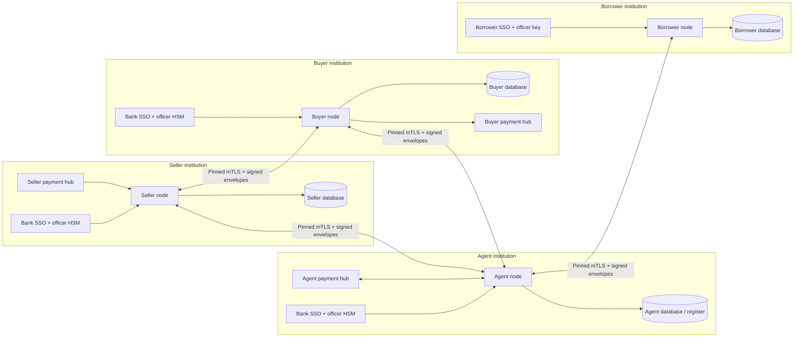

# Institution node architecture

The node runtime never opens another node's database. A database is bound to one
node ID, role and signing public key; accidental reuse by another identity fails
before bank data is read. Private keys/data keys are not shared between nodes.

## Local institution interfaces

- **Peer TLS listener:** only pinned institution certificates and fixed peer message schemas/routes.
- **Officer TLS listener:** a separate trust store containing only that institution's officer certificates. Signed officer commands bind exact task hashes. In production bank JWT identity and fresh MFA are also required for approvals/imports/financial requests.
- **REST/UI listener:** pinned bank OIDC verifies identity and audience, maps the employee subject to local roles, verifies fresh MFA and uses that officer's PKCS#11 key. No shared password or role-switch endpoint exists.
- **Payment hub:** local bank file boundary. Peers cannot inject booked credits. Production exports/imports must validate against the bank's configured XSDs. Runtime code never contacts Fedwire, ACH or SWIFT.

No institution node contains a registry of another bank's private officer keys.
Peer officer **public** keys/roles are provisioned through the approved identity
registry so approval signatures can be verified independently.

## Durable effects

Verified inbound messages are audit-recorded before dispatch. Business effects
and the inbound execution result commit in one database transaction, serialized
by a node-local PostgreSQL advisory lock. Reusing an execution ID with another
payload/type/trade is rejected. Reusing it with the original payload returns the
original result without repeating the effect.

Approvals enqueue immutable, encrypted outbox records in the same transaction as
the local state transition. The dispatcher signs a fresh envelope, verifies the
pinned peer and signed reply, then records delivery. A timeout/crash after claiming
an item produces reconciliation state rather than a new execution. The remote
execution-status query returns a signed answer tied to the originating peer.

The settlement transaction rechecks the local register, all relevant signatures,
consents, KYC and exact unconsumed booked credit. It consumes that credit, moves
seller→buyer while conserving the register total, creates one seller disbursement
intent and queues three signed receipts atomically. Each recipient deduplicates
its own book update and sends a signed receipt acknowledgment.

Payment exports have a separate durable state machine. The XML is written,
fsynced and published without overwriting an existing execution filename. Crashes
in the export window are marked uncertain on restart; no blind re-export occurs.

## Bank integration boundary

The built-in institution ledger and signed initialization interface are usable
infrastructure. They do not establish that a bank's existing Loan IQ/OMS/treasury
system is synchronized. The institution must establish the authoritative source,
read/write adapter mappings, execution reconciliation and ownership of the
register before actual lending positions are processed. That integration cannot
be inferred from a passing fixture run.
