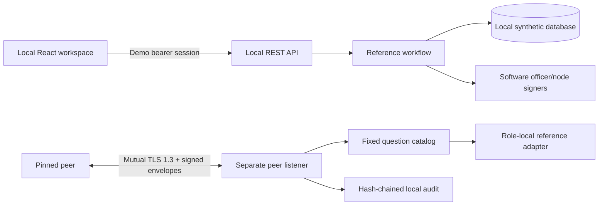

# Security boundaries and review scope

## Deployment boundary

Reference only. Do not load real positions, SSI, KYC or identity credentials. The
synthetic workflow intentionally houses multiple roles' fixtures in one process
for UI evaluation. That architecture must never be deployed as a central bank-data
service. Production startup is disabled until the missing controls in STATUS.md
are delivered and validated.

No peer endpoint exposes the REST API. No cloud telemetry or LLM is in the runtime
path. No Fedwire/ACH/SWIFT connectivity exists. No KYC or SSI export route exists in
the local API. Raw adapter data is not returned by catalog answers; the specified
question parameters remain present in the signed answer. Network KYC/SSI actions
are disabled rather than implicitly releasing documents or account numbers.

## Review focus

- TLS peer pin mapping and TLS 1.3-only enforcement, rejected certificate handling.
- Signature canonicalization, replay windows, request/response nonce binding,
  concurrency, timestamp validation and oversized/slow requests.
- Catalog role matrix, own-position/own-SSI binding, disabled and narrowed policy.
- Approval payload hashes, duplicate officers, stale packages/SSI, rejection
  reasons, document terms and signatures, atomic settlement preconditions.
- Exact credit amount/account/execution reconciliation, transactional register
  conservation, idempotency, uncertain outcomes and future outbox dispatch.
- Local REST authorization and CSRF/origin protection. Demo sessions are deliberately
  weaker than bank authentication and must not be reused in production.
- Audit immutability, permissions, redaction/retention and export destinations.

SQLite triggers reject ordinary UPDATE/DELETE of the audit table; a DB owner can
still alter the database. Hash verification detects ordinary mutation, not a
privileged adversary recomputing the entire chain. Production requires separate
least-privilege roles and external WORM anchoring. PostgreSQL integrity/locking is
exercised separately when available; no production append-only role is provisioned.

Encryption at rest, SSO/MFA and live HSM integration are NOT complete. The HSM
backend takes a PIN from its host caller; do not store it in YAML or logs. TLS,
checksums and package verification must remain enabled during installation.
